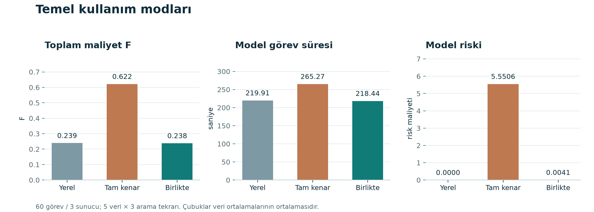
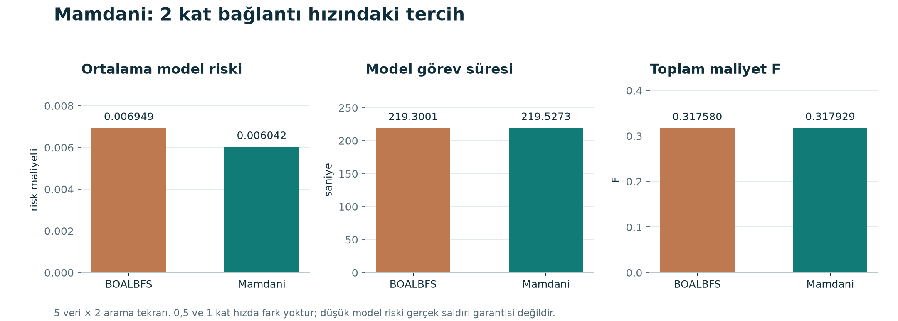

# Bulanık Güvenlik ile Görev Aktarma

Endüstriyel kenar bilişimde bir hesaplama görevinin **hangi sunucuda** ve
**ne kadarının uzakta** işleneceğini seçen Python simülasyonu. Görev süresi,
bulanık güvenlikten türetilen model riski ve sunucu yük dengesi birlikte değerlendirilir.

**Ali Kemal Dilek · 1306230043**<br>
İstanbul Üniversitesi-Cerrahpaşa · Bilgisayar Mühendisliği · Bulanık Mantık

## Rapor ve sunum

- [Teknik proje raporu](report/Bulanik_Mantik_Proje_Raporu.pdf)
- [PowerPoint sunumu — 18 slayt](presentation/Bulanik_Mantik_Proje_Sunumu.pptx)

Sunum, proje sonuçlarını ve kullanım akışını içerir.

## Yöntem ve katkılar

Temel kaynak: X. Jin, S. Zhang, Y. Ding ve Z. Wang,
“Task offloading for multi-server edge computing in industrial Internet with
joint load balance and fuzzy security,” *Scientific Reports*, 2024.
[Makale ve denklemler](https://www.nature.com/articles/s41598-024-79464-2).

1. **Bulanık güvenlik:** uzmanların üçgen değerlendirmeleri ağırlıklandırılır;
   güvenlik puanı ve gönderim riski hesaplanır.
2. **Ortak değerlendirme:** cihaz, iletim ve sunucu süreleri; kaynak kapasitesi;
   yük varyansı ve normalize toplam maliyet `F` hesaplanır.
3. **BOALBFS:** adaptif genetik algoritma (GA) sunucu/yerel konumunu, SA-PSO
   gönderim oranını arar. En iyi gözlenen uygun plan korunur.
4. **Mamdani katkısı:** güvenlik puanı `S` ve değerlendirme üçgenlerinin ortalama
   genişliği `U`, dokuz kuralla görev başına izinli üst gönderim oranına dönüştürülür.
5. **Analitik oran çalışması:** sunucu seçimleri sabitken modelin doğrusal yapısı
   kullanılarak oran aramasının hesaplama maliyeti azaltılır.

Mamdani denetleyicisi projeye eklenen ayrı bir katmandır; makalenin özgün bulanık
güvenlik hesabıyla karıştırılmamalıdır.

Bulanık mimari: uzman üçgenleri → ağırlıklı güvenlik puanı `S` ve ortalama
genişlik `U` → düşük/orta/yüksek üyelikler → dokuz Mamdani kuralı → min/max
çıkarım → centroid ile üst gönderim oranı → aynı GA/SA-PSO araması.
[Denklem eşlemesi ve yöntem ayrıntıları](references/README.md).

Gerçekleştirme kapsamı, makalenin çekirdek bulanık güvenlik, süre/yük ve
BOALBFS yöntemini uygulamak ve temel mod deneyini sınamaktır. Bütün makale
şekillerini ve rakip algoritmaları yeniden uygulama iddiası yoktur.

## Kurulum ve çalıştırma

Kaydedilmiş geliştirme ortamı **Windows / Python 3.14.5** kullanır.
PowerShell'de:

```powershell
git clone https://github.com/al1code/fuzzy-security-task-offloading.git
cd fuzzy-security-task-offloading
py -3.14 -m venv .venv
.\.venv\Scripts\python.exe -m pip install -r requirements-gui.txt
.\.venv\Scripts\python.exe -m streamlit run app.py
```

[Uygulamayı aç](http://127.0.0.1:8501). Terminal açık kalmalıdır; durdurmak için
`Ctrl+C` kullanılır. Port doluysa son komuta `--server.port 8502` eklenebilir.
GitHub'dan ZIP indirildiyse `app.py` bulunan klasörde sanal ortam adımından başlanır.
`.venv/` başka bilgisayara kopyalanmaz.

Bağımlılık dosyaları:

| Dosya | Kapsam |
| --- | --- |
| `requirements.txt` | Sayısal çekirdek ve komut satırı deneyleri |
| `requirements-gui.txt` | Sabit çekirdek sürümleri ve sabit Streamlit bağımlılıkları |
| `requirements-dev.txt` | Çekirdek, test ve kod denetimi araçları |
| `requirements-lock.txt` | Çekirdek ve test ortamının sabit sürümleri |

### İlk kullanım

1. **3 görev, 2 sunucu, veri seed 42, güvenlik eşiği 0,60** ile senaryo oluştur.
2. **Projeyi Anla** ekranından modelin girdilerini ve örnek hesabı incele.
3. **Bulanık Güvenlik** ekranında uzman üçgenlerinden güvenlik puanına geçişi gör.
4. **Çözüm Karşılaştırması** ekranında Local, BOALBFS ve Mamdani yöntemlerini çalıştır.
5. **Mamdani Katkısı** ekranında `S` ve `U` için izin verilen oranı incele.

Mamdani sürgüleri kural önizlemesidir; görev girdilerini değiştirmez.
Daha küçük `F`, aynı girdiler ve ağırlıklar altında daha düşük toplam maliyettir.

## Veri ve tekrar üretilebilirlik

Özgün yazar girdileri ve kaynak kodu bu projede bulunmuyor. Deneylerde makalede
bildirilen aralıklar ve açık proje varsayımlarıyla üretilmiş **sentetik veriler**
kullanılıyor. Parametrelerin kaynağı ve birimleri
[veri belgesinde](references/synthetic_data.md), kodda ve raporda açıklanır.

Üretilmiş görev verileri depoya eklenmez; `synthetic_demo` komutuyla
yerelde yeniden oluşturulur. Örnek ayar: 60 görev, 3 sunucu, seed 42.
Yerel kayıtlar gerçek girdileri, yapılandırmayı, tohumları, yazılım sürümlerini
ve dosya karmalarını içerir. Aynı tohum tek başına farklı kütüphane sürümlerinde
özdeş sonuç garantisi değildir. Arama süreleri donanıma ve sistem yüküne bağlıdır.

Rapor ve sunumdaki sonuçlar [Türkçe karşılaştırma tabloları](results/tables/README.md)
ve [PNG grafikler](results/figures/README.md) olarak paylaşılır. Bunların dayandığı
**225 koşuluk sayısal ölçümler**, yaklaşık 28 KB'lık
[CSV dosyasındadır](results/tables/recorded_runs.csv).
Tekrarlanan görev JSON'ları, tam planlar, ham deney paketleri ve SVG dosyaları
Git dışında tutulur; tohumlar ve deney ayarları belgelerde korunur.
Yeni klonda Deney Kayıtları ekranının boş olması normaldir. Küçük örnek
doğrudan çalışır; tam deney komutları kayıt paketlerini yeniden oluşturur. Mevcut çıktı
klasörü üzerine yazılmaz; tekrar çalıştırırken yeni bir klasör adı seçilir.

## Komut satırı örnekleri

Aşağıdaki komutlar depo kökünde çalıştırılır:

```powershell
# Bulanık güvenlik hesabı ve ara değerler
.\.venv\Scripts\python.exe -m experiments.baseline.fuzzy_security_demo

# Yerel, kısmi ve tam gönderimin süreleri
.\.venv\Scripts\python.exe -m experiments.baseline.offloading_demo

# Sentetik girdileri yerelde üret ve kaydet
.\.venv\Scripts\python.exe -m experiments.baseline.synthetic_demo --seed 42 --output data/generated/synthetic_seed42.json

# Kaydedilen aynı girdileri yeniden oku
.\.venv\Scripts\python.exe -m experiments.baseline.synthetic_demo --input data/generated/synthetic_seed42.json

# Küçük örnekte BOALBFS ile kesin referansı karşılaştır
.\.venv\Scripts\python.exe -m experiments.baseline.genetic_demo --method boalbfs --tasks 3 --servers 2 --verify-exact
```

## Rapor ve sunumdaki deneyleri çalıştırma

```powershell
# A: Local / Edge / Local-Edge — 5 veri, 3 arama tekrarı
.\.venv\Scripts\python.exe -m experiments.baseline.mode_comparison --output results/reproduction_modes

# B: Mamdani ve temel yöntem — 5 veri, 2 tekrar, 3 bağlantı hızı
.\.venv\Scripts\python.exe -m experiments.proposed.uncertainty_mamdani_comparison --output results/reproduction_mamdani --tasks 60 --servers 3 --data-seeds 7 21 42 84 2026 --optimizer-seeds 0 1 --population 6 --generations 3 --particles 4 --pso-iterations 5 --link-rate-factors 0.5 1 2

# C: Aynı konumlarda ek sınır yok / sabit sınır / yalnız S / tam S-U kontrolü
.\.venv\Scripts\python.exe -m experiments.proposed.contribution_audit --output results/reproduction_policy_controls

# D: Sabit konumlarda SA-PSO ve analitik oran hesabı
.\.venv\Scripts\python.exe -m experiments.proposed.ratio_comparison --output results/reproduction_ratios

# E: Tam GA akışında SA-PSO ve analitik oran hesabı
.\.venv\Scripts\python.exe -m experiments.proposed.ratio_comparison --scope pipeline --output results/reproduction_pipelines
```

Deneyler uzun sürebilir; hızlı kontrol için küçük senaryo kullanılmalıdır.

Depodaki ham kayıtlardan özet tabloları ve grafikleri yeniden oluşturmak için:

```powershell
.\.venv\Scripts\python.exe -m experiments.summarize_results
```

Bu komut saklanan planları yeniden optimize etmez; kayıtlı ölçümleri özetler.
Deney paketleri, koşulları ve raporla eşlemesi [sonuç dizininde](results/README.md) açıklanır.

### Kaydedilmiş sonuçların özeti

| Karşılaştırma | Gözlenen sonuç | Yorum sınırı |
| --- | --- | --- |
| Local-Edge / Local | Ortalama eşleştirilmiş `F` kazancı yaklaşık %0,47 | Makaledeki %46 sonucunun tekrarı değildir |
| Mamdani / BOALBFS, 2 kat bağlantı hızı | Ortalama model riski %13,05 azaldı; süre %0,104 ve `F` %0,110 arttı | 0,5 ve 1 kat hızda bu arama bütçesiyle fark oluşmadı |
| Sabit sınır / tam Mamdani | Sabit sınır da risk azalması sağladı | Mamdani bütün ölçütlerde üstün değil |
| GA + analitik / GA + SA-PSO | Ortalama plan arama süresi yaklaşık 51,68 kat kısaldı | Aynı üst GA bütçesi; görev süresi değildir; ortalama model riski arttı |

Bu değerler rapordaki kayıtlı sentetik deneylerin özetidir; yeni çalıştırmanın
özellikle zaman ölçümü farklı olabilir. Bağımsız veri sayısı beştir;
aynı verideki arama tekrarları yeni veri örnekleri sayılmaz.





## Test ve kod denetimi

```powershell
.\.venv\Scripts\python.exe -m pytest -p no:cacheprovider tests -q
.\.venv\Scripts\python.exe -m ruff check --no-cache src tests experiments gui app.py
.\.venv\Scripts\python.exe -m ruff format --check --no-cache src tests experiments gui app.py
git diff --check
```

Testler elle hesaplanan örnekleri, geçersiz girdileri, kapasite sınırlarını,
Mamdani kurallarını, küçük kesin çözümleri, kayıt tekrar hesabını ve arayüz
etkileşimlerini kapsar. Test sonuçları gerçek fabrika deneyi yerine geçmez.

## Kapsam ve sınırlılıklar

- Uygulama bir simülasyondur; gerçek cihazlara görev göndermez.
- Model riski ölçülmüş saldırı olasılığı değildir. `U`, üçgenlerin genişliğidir;
  uzmanlar arası anlaşmazlığın doğrudan ölçüsü değildir.
- Makaledeki çekirdek yöntem yeniden uygulanmıştır; bütün rakip algoritmalar,
  deney şekilleri ve yayımlanmış yüzdeler tekrarlanmamıştır.
- Pozitif toplam risk ve eşit amaç ağırlıklarında kullanılan normalizasyon,
  tam kenar planının yerelden daha düşük `F` almasını engeller. Sonuç farkının
  tek nedeni özgün verilerin bulunmaması değildir.
- Kuyruk, enerji, şifreleme maliyeti ve paralel tamamlanma zamanı modelde yoktur.
  Süre, görevlerin cihaz/iletim/sunucu sürelerinin toplamıdır.
- GA ve SA-PSO global optimum garantisi vermez. Analitik oran çözümünün
  kesinliği yalnız sabit konum, kaynak ve normalizasyon koşullarındaki alt probleme aittir.
- Mamdani kuralları gerçek saldırı verisiyle kalibre edilmemiştir; bütün
  ara noktalarda monotonluk veya her koşulda performans üstünlüğü iddia edilmez.

## Depo düzeni

```text
app.py                  Streamlit başlangıcı
gui/                    Arayüz ve çekirdeğe bağlanan servisler
src/                    Model, hesaplama, veri ve doğrulama
src/optimizers/         GA, SA-PSO ve kesin/analitik kontroller
experiments/baseline/   Temel yöntem deneyleri ve küçük örnekler
experiments/proposed/   Mamdani ve analitik oran deneyleri
experiments/summarize_results.py  Kaydedilmiş sonuçlardan tablo/grafik üretimi
tests/                  Birim ve bütünleştirme testleri
data/generated/         Yerelde üretilen girdiler; Git dışında
data/author_provided/   Varsa yerel yazar verisi; Git dışında
results/                Paylaşılan deney kayıtları ve sonuç dizini
results/figures/        Açıklamalı grafik galerisi; PNG görseller
results/tables/         Doğrudan okunabilen Türkçe tablolar ve CSV indirmeleri
results/archive/        Yerel ham deney kayıtları; Git dışında
references/             Kaynakça, yöntem ve veri varsayımları
report/                 Son teknik rapor
presentation/           Son PowerPoint sunumu
```

## Kaynaklar ve yapay zekâ kullanımı

[Kaynakça ve teknik eşleme](references/README.md) ile raporun kaynakça bölümü
ilgili kaynakları içerir. Yazarın kaynak kodu kullanılmamıştır.
ChatGPT ve Codex; kod, açıklama, inceleme ve dokümantasyon desteğinde kullanılmıştır.
Bu kullanım raporda açıklanır.

Kullanım ve telif koşulları: [LICENSE](LICENSE).
