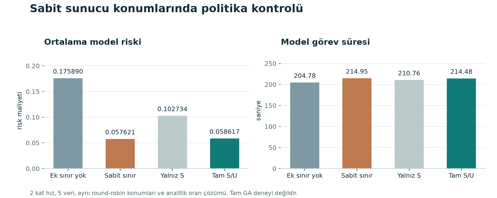
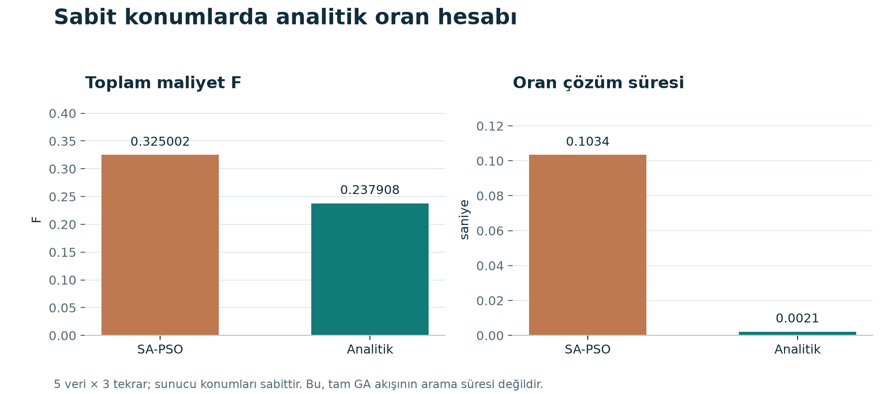
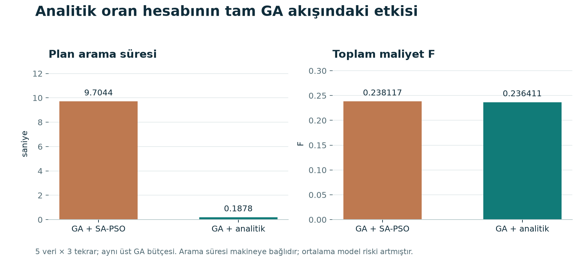

# Grafik galerisi

Beş deneyin neyi karşılaştırdığını ve ne sonuç verdiğini bu sayfadan okuyabilirsin. [Sayısal tablolar](../tables/README.md) · [Sonuçların genel görünümü](../README.md)

## A — İş nerede çalıştırılmalı?

Aynı görevleri tamamen cihazda, tamamen sunucularda veya iki tarafta birlikte çalıştırmayı karşılaştırdım. 60 görev, 3 sunucu; 5 veri seti × 3 arama tekrarı × 3 mod = 45 kayıt.

**Sonuç:** Birlikte kullanımın toplam maliyeti F en düşük çıktı; yerel çözüme göre eşleştirilmiş ortalama kazanç yaklaşık %0,47 ile küçük kaldı. Makaledeki %46 kazancı bu koşullarda tekrar elde etmedim.

[PNG](baseline_modes.png) · [Sayısal tablolar](../tables/README.md) · [CSV](../tables/baseline_modes.csv)

## B — Mamdani gönderim sınırı neyi değiştirdi?

Temel BOALBFS ile görev başına Mamdani üst sınırı eklenen sürümü aynı girdilerde karşılaştırdım. 5 veri seti × 2 arama tekrarı × 3 bağlantı hızı × 2 yöntem = 60 kayıt.

**Sonuç:** 2 kat bağlantı hızında model riski yaklaşık %13,05 azaldı; görev süreleri toplamı %0,104 ve F %0,110 arttı. 0,5 ve 1 kat hızda bu arama bütçesiyle yöntemler tamamen yerelde kaldı; seçilen plan, F, risk ve görev süresi aynı çıktı. Planı aramak için harcanan süreler farklıdır. Katkı, risk ile süre arasındaki tercihi değiştiriyor.

[PNG](mamdani_tradeoff.png) · [Sayısal tablolar](../tables/README.md) · [CSV](../tables/mamdani_pipeline.csv)

## C — Risk azalması yalnız Mamdani sayesinde mi?

Aynı round-robin sunucu konumlarında dört oran politikasını karşılaştırdım. Oranlar analitik çözüldü. 5 veri seti × 3 bağlantı hızı × 4 politika = 60 kayıt; tam GA deneyi değildir.

**Sonuç:** Sabit sınır da model riskini belirgin azalttı. 2 kat hızda tam Mamdani, sabit sınırdan biraz daha kısa süre ve düşük F; biraz daha yüksek risk verdi. Sonuçlar, risk düşüşünün tamamını U girdisinin özel başarısına bağlamıyor.

[PNG](policy_controls.png) · [Sayısal tablolar](../tables/README.md) · [CSV](../tables/policy_controls.csv)

## D — Sunucu seçimi sabitken oranı nasıl hesaplamalı?

Sunucuları değiştirmeden SA-PSO oran araması ile analitik oran hesabını karşılaştırdım. 5 veri seti × 3 arama tekrarı × 2 yöntem = 30 kayıt.

**Sonuç:** Bu model ve bütçede analitik hesap daha düşük F ve daha kısa oran çözüm süresi verdi. Sunucu seçimi sabit olduğundan bu, bütün sistemin global optimumu veya tam GA hızlanması değildir; tam akışın sonucu E tablosundadır.

[PNG](analytical_fixed_locations.png) · [Sayısal tablolar](../tables/README.md) · [CSV](../tables/ratio_fixed_locations.csv)

## E — Analitik hesap tam GA akışında ne kazandırdı?

GA konum aramasının altında SA-PSO veya analitik oran hesabı kullandım. Aynı üst GA bütçesiyle 5 veri seti × 3 arama tekrarı × 2 yöntem = 30 kayıt.

**Sonuç:** Kaydedilen ortalama plan arama süresi 9,7044 saniyeden 0,1878 saniyeye indi: yaklaşık 51,68 kat daha kısa. F de azaldı; ancak ortalama model riski arttı. Arama süresi görevlerin çalışma süresi değildir ve makineye bağlıdır.

[PNG](analytical_pipeline.png) · [Sayısal tablolar](../tables/README.md) · [CSV](../tables/ratio_pipeline.csv)

## Ölçüm sınırları

Model riski saldırı olasılığı değildir. Görev süresi model hesabıdır; plan arama süresi gerçek program süresidir. Bütün deneyler sentetik girdilerle yapılmıştır. Farklı hız koşullarının F değerleri tek başına iyileşme yüzdesi olarak yorumlanmamalıdır.
